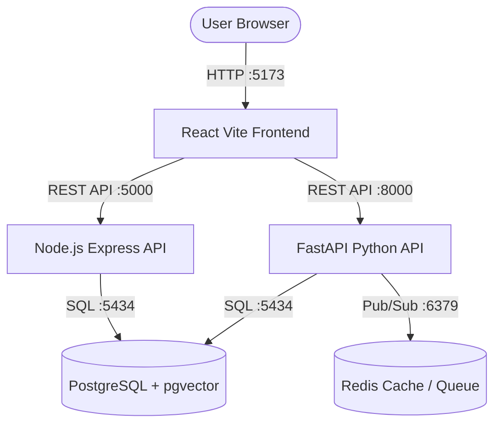

# 🤖 AI Digital Twin Full-Stack Monorepo

A modern, high-performance AI Digital Twin application that empowers students through active learning. It features a **React (Vite) Frontend**, dual backends with **Node.js Express API** and **FastAPI Python (Vector Store / AI Processing)**, supported by **PostgreSQL (pgvector)** and **Redis**.

---

## 🏗️ Architecture Overview



---

## ⚡ Core Features

- **File Ingestion & Background Processing**: 
  - Drag-and-drop PDF upload UI.
  - Background async text extraction using `pdfplumber` & Tesseract OCR via Celery + Redis, preventing UI freezes.
  - Generates 1536-dimensional semantic vector embeddings (via LangChain + Gemini/OpenAI) and stores them in PostgreSQL using `pgvector`.
- **Bayesian Knowledge Tracing (BKT)**: 
  - Tracks and updates student mastery scores dynamically based on quiz results.
  - Provides a real-time mastery progress dashboard for parents and students.
  - Uses Postgres snapshot versioning for historical progress tracking.
- **Struggle Topic Predictor**:
  - Algorithmic ranking of weak topics based on: `(1 - Mastery) × Syllabus Weight × Time Decay`.
  - Node.js layer utilizes Redis caching to swiftly render a "Top Struggles" widget on the student dashboard.
- **Grounded RAG Quiz Engine**:
  - Auto-generates multi-choice quizzes strictly grounded in the student's uploaded notes.
  - Uses LangChain RAG vector retrieval (`cosine_distance` over `pgvector`) to find relevant material.
  - Connects to Gemini 1.5 Flash to generate structured JSON containing questions, exact answers, explanations, and precise source citations.

---

## 📂 Project Structure

```text
ai-digital-twin/
├── database/
│   ├── migrations/
│   │   └── init.sql         # PostgreSQL schema & pgvector initialization
│   ├── models.py            # SQLAlchemy ORM Models
│   ├── seed_syllabus_weights.py # DB Seeding script for syllabus
│   └── session.py           # DB connection session factory
├── fastapi-backend/
│   ├── app/                 # FastAPI app & routes (RAG, BKT, LLM, services)
│   ├── tests/               # Pytest test suites
│   ├── worker/              # Celery background tasks for PDF extraction
│   ├── Dockerfile
│   └── requirements.txt     # Python dependencies
├── node-backend/
│   ├── models/              # Express models (e.g., Payment)
│   ├── src/                 # Express controllers, routes, Redis caching
│   ├── Dockerfile
│   └── package.json         # Node.js dependencies
├── frontend/
│   ├── public/              # Static assets
│   ├── src/                 # React UI (Dashboard, Auth, Uploads, Services)
│   ├── Dockerfile
│   ├── package.json         # React dependencies
│   └── vite.config.js       # Vite configuration
├── fix_*.py                 # Utility python scripts to clean codebase
├── test_revision.py         # Utility script for testing revisions
├── reset_student_password.py # Utility script to reset student passwords
├── docker-compose.yml       # Multi-container orchestrator
├── package.json             # Root monorepo scripts
├── start.bat                # Windows one-click launcher script
├── .env.example             # Template for environment variables
├── .gitignore               # Git ignored files
├── .dockerignore            # Docker ignored files
└── README.md
```

---

## 🚀 Getting Started

### Prerequisites
- **Node.js** 18+ and **Python** 3.10+ (`python3` on macOS/Linux)
- **Docker Desktop** (running) - provides PostgreSQL + pgvector and Redis
- A free **Gemini API key** - https://aistudio.google.com/apikey

### Run it (Windows, macOS, Linux)

```bash
git clone <repository-url>
cd ai-digital-twin
npm start
```

`npm start` (or double-click `start.bat` on Windows) does everything:
1. creates `.env` from `.env.example` if it is missing,
2. installs the Node and Python dependencies on the first run,
3. starts PostgreSQL (`:5434`) and Redis (`:6379`) in Docker and waits until they are healthy,
4. launches the Node API (`:5000`), FastAPI (`:8000`), the Celery worker and the React app (`:5173`).

**Before your first real session, open `.env` and set `GEMINI_API_KEY`**, then restart.
Open **http://localhost:5173**, sign up, upload a PDF under *Upload*, then use *Test Practice*.

Database tables are created and upgraded automatically on every FastAPI start - there is no manual migration step.

Already have your own Postgres (with the `pgvector` extension) and Redis? Put their URLs in `.env` and run `SKIP_DOCKER=1 npm start`
(on Windows PowerShell: `$env:SKIP_DOCKER=1; npm start`).

### Run everything in Docker instead
```bash
npm run docker:up      # = docker compose up --build   (UI on http://localhost:5173)
npm run docker:down
```
`GEMINI_API_KEY`, `RAZORPAY_*` etc. are read from your `.env` and passed into the containers.

### Scanned PDFs (OCR)
Image-only PDFs are read with Tesseract OCR. Docker already includes it. For `npm start`, install
[Tesseract](https://github.com/tesseract-ocr/tesseract) and [Poppler](https://poppler.freedesktop.org/) and make sure they are on your PATH,
or set `TESSERACT_CMD` / `POPPLER_PATH` in `.env`.

### Troubleshooting
| Symptom | Fix |
| :--- | :--- |
| "Docker was not found" / containers fail | Start Docker Desktop, or use `SKIP_DOCKER=1` with your own Postgres + Redis |
| Notes list shows an error with **Retry** | FastAPI isn't running or is busy - check the `FASTAPI` log lines |
| Quiz/viva fails | `GEMINI_API_KEY` missing or invalid in `.env` |
| Pro Plan payment fails | Add Razorpay test keys (`RAZORPAY_*`) to `.env` |
| `vector` extension error | Postgres must be pgvector-enabled (the Docker image `pgvector/pgvector:pg16` is) |

---

## 🌐 Service URLs & Health Endpoints

| Service | Local URL | Description |
| :--- | :--- | :--- |
| **Frontend** | `http://localhost:5173` | React UI (Dashboard, Quiz, Library) |
| **Node.js API** | `http://localhost:5000` | Primary Express Backend & Auth |
| **FastAPI** | `http://localhost:8000` | Python AI Backend, RAG, & BKT |
| **PostgreSQL** | `localhost:5434` | `twin_db` database |
| **Redis** | `localhost:6379` | Cache & Queue |

---

## 🛠️ API Quick Reference

### Node.js Backend (`http://localhost:5000`)
- `POST /api/login` - Authenticate users
- `POST /api/students` - Create a student profile
- `GET /api/students` - Get all students
- `GET /api/students/:student_id/top-struggles` - Ranked struggle predictions (Redis cached)
- `POST /api/create-order` - Create Razorpay payment order
- `POST /api/verify` - Verify Razorpay payment
- `POST /api/webhook` - Razorpay webhook handler

### FastAPI Backend (`http://localhost:8000`)
- `POST /api/v1/login` - FastAPI authentication
- `POST /api/v1/students` - Create a student profile
- `POST /api/v1/upload-pdf` - Async PDF parsing and chunking
- `POST /api/v1/tests/generate` - RAG-based LLM Quiz Generation
- `POST /api/v1/tests/{test_id}/submit` - Submit test and evaluate score
- `POST /api/v1/mastery/update` - BKT Mastery engine updates
- `GET /api/v1/mastery/{student_id}` - Get student's overall mastery data
- `GET /api/v1/struggle-data/{student_id}` - Detailed struggle topic metrics
- `GET /api/v1/revision/{student_id}/plan` - Get SM-2 spaced repetition revision plan
- *(Also includes Viva voice Q&A and Guardian access routes)*

---

## 📜 License

ISC License
